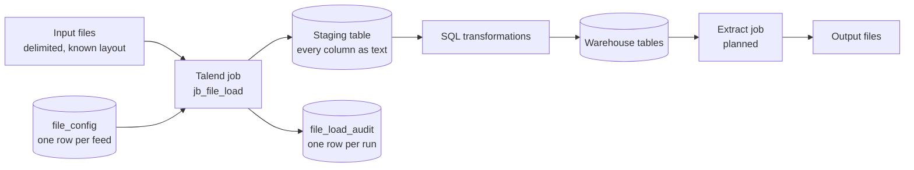
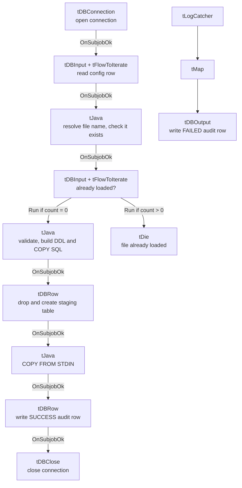
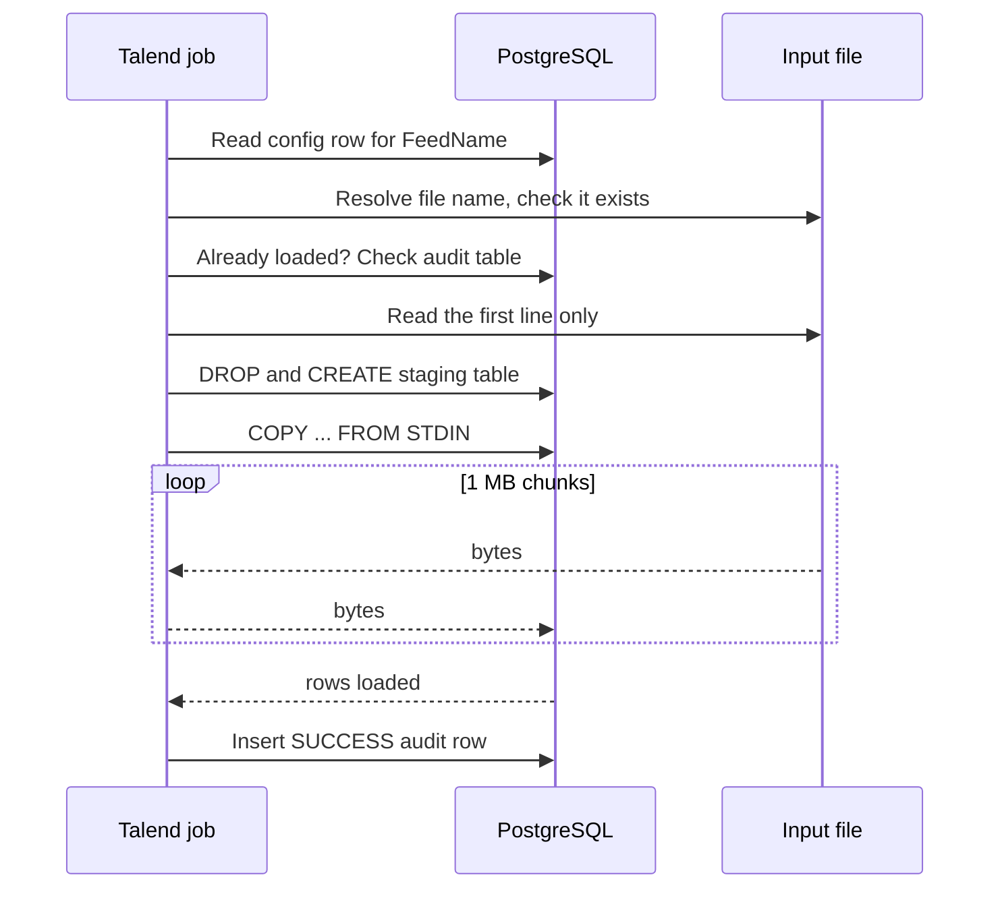
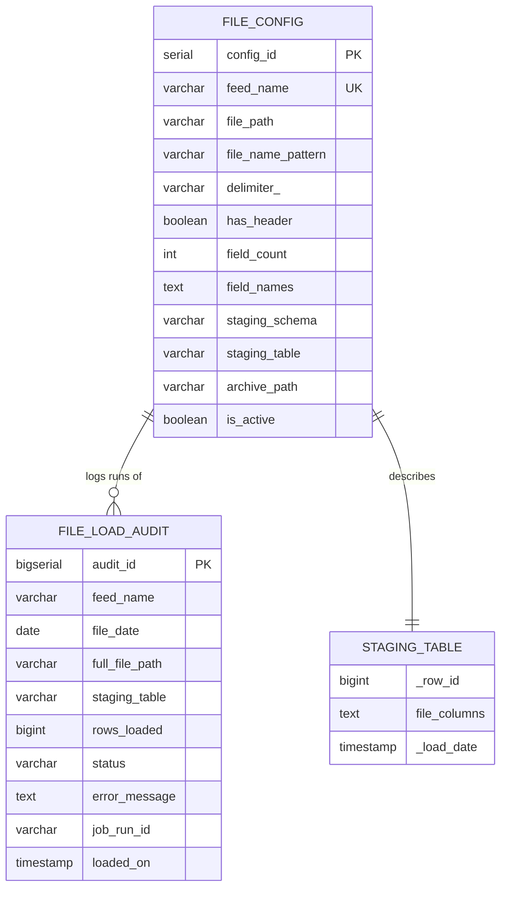

# Metadata-Driven File Load with Talend and PostgreSQL

Load any delimited file into PostgreSQL staging tables with **one Talend job** and **one config table**. Adding a new feed means inserting a row into `file_config`. No new job, no redeployment.

> **Status:** the load job (`jb_file_load`) is implemented. The extract job (table or query to file) follows the same pattern and is on the roadmap below.

This project is the Talend and PostgreSQL counterpart of our SSIS and SQL Server implementation. Both follow the same design: a config table describes the file, a small amount of generated SQL does the work, and the database reads the data in bulk.

---

## Why code and not AI?

Most warehouse ETL follows the same flow: structured files are loaded into staging, the data is processed and transformed, and the result is extracted for analysis. The two ends of that flow, loading and exporting, handle files with a known structure: a delimiter, a header or a fixed list of fields, and a predictable file name. Structure like that can be described once and automated with ordinary code.

We were asked to use AI for this and chose not to:

- **Cost follows volume.** AI models bill per token, so millions or billions of records mean billions of tokens on every run. Code on a database you already run costs almost nothing per row.
- **Same input, same output.** A deterministic loader behaves identically every time. Even a tiny error rate becomes a lot of bad rows at this scale.
- **Speed.** PostgreSQL's `COPY` reads data as a stream. A round trip to a model for every chunk cannot compete.
- **Control.** Data stays inside your environment, and every step can be audited and replayed.

AI is still useful for unstructured sources, for exploring an unfamiliar file, and for helping to write the code. Use AI to build the pipeline, and use code to run it.

---

## How it works at a glance



1. The job receives two context values: `FeedName` and `FileDate`.
2. It reads the feed's row from `file_config` and builds the real file name from the pattern and the date.
3. It stops if the audit table already has a SUCCESS row for that file.
4. It reads only the first line of the file and validates the structure.
5. It generates and runs the staging table DDL.
6. It streams the file into the table with `COPY ... FROM STDIN`.
7. It writes a SUCCESS audit row. Any failure writes a FAILED row.

---

## Job design

### Components

The job uses generic `tDB*` components (`tDBConnection`, `tDBInput`, `tDBRow`, `tDBOutput`, `tDBClose`). The PostgreSQL-specific `tPostgresql*` components work the same way.

| Subjob | Components | What it does |
|---|---|---|
| Connect | `tDBConnection_1` | Opens one shared connection with auto commit on. |
| Read config | `tDBInput` → `tFlowToIterate` → `tJava` | Reads the config row and exposes each column as a global variable such as `row1.file_path`. |
| Resolve file | `tJava` | Replaces date tokens in the file name pattern, checks the file exists, stores `fullFilePath`. |
| Duplicate check | `tDBInput` → `tFlowToIterate` → `tJava` | Counts SUCCESS rows in the audit table for this file. |
| Parse | `tJava` | Validates the field count, sanitizes column names, builds `ddlSql` and `copySql`. Runs only if the count is 0. |
| Stop | `tDie` | Runs if the file was already loaded. |
| Create staging table | `tDBRow` | Runs `ddlSql` (drop and create). |
| Load file | `tJava` | Streams the file through the JDBC `CopyManager`. |
| Audit | `tDBRow` | Inserts the SUCCESS row. |
| Close | `tDBClose` | Closes the connection. |
| Error path | `tLogCatcher` → `tMap` → `tDBOutput` | Catches any failure and inserts a FAILED row. |

### Control flow



`tLogCatcher` is not linked to the main flow. It fires on its own when any component throws an exception or `tDie` runs.

### Load sequence



The data passes through the job as a byte stream, one chunk at a time. Nothing is parsed or held in memory, so memory use stays flat whatever the file size.

### Structure validation

- File **has a header:** the header's field count must equal `field_count`, and the header supplies the column names.
- File **has no header:** the names come from `field_names` in the config, their count must equal `field_count`, and the first data row must have the same number of fields.
- Column names are sanitized: unsafe characters become underscores, names are lower-cased, empty names become `col1`, `col2`, and duplicates get a numeric suffix.

---

## Data model



A partial unique index on `file_load_audit (feed_name, full_file_path) WHERE status = 'SUCCESS'` stops the same file from being recorded as loaded twice.

---

## Context variables

| Variable | Purpose |
|---|---|
| `DB_HOST`, `DB_PORT`, `DB_NAME` | PostgreSQL server and database. |
| `DB_USER`, `DB_PASS` | Credentials. Do not commit real values. |
| `DB_SCHEMA` | Schema that holds the config, audit and staging tables. |
| `FeedName` | Which `file_config` row to use. |
| `FileDate` | Date in `yyyy-MM-dd` format, used to build the file name. |

The job stores these values in the Talend global map:

| Key | Set by | Used by |
|---|---|---|
| `row1.<column>` | Config `tFlowToIterate` | Resolve, parse. The prefix is the row link name. |
| `row2.cnt` | Duplicate-check `tFlowToIterate` | The Run if conditions. |
| `fullFilePath` | Resolve `tJava` | Duplicate check, parse, copy, audit. |
| `ddlSql`, `copySql`, `stagingFq` | Parse `tJava` | DDL, copy and audit steps. |
| `rowsLoaded` | Copy `tJava` | Audit step. |

Key names depend on your link names. If you rename a link to `cfg`, the keys become `cfg.file_path` and so on, and the code must match.

---

## Setup

1. Create the tables (see `sql/`).
2. Create a Talend context group with the variables above.
3. Import the job, set the connection settings, and make sure the PostgreSQL JDBC driver is available.
4. Insert a row in `file_config`, for example:

```sql
INSERT INTO test.file_config
    (feed_name, file_path, file_name_pattern, delimiter_, has_header, field_count, staging_table)
VALUES
    ('CUSTOMER', 'E:/Data/inbound', 'CUSTOMER_{yyyyMMdd}.csv', ',', true, 5, 'stg_customer');
```

5. Run the job with `FeedName = CUSTOMER` and `FileDate = 2026-10-20`.

To run it outside Studio, build the job and call the generated script:

```text
jb_file_load_run.bat --context_param FeedName=CUSTOMER --context_param FileDate=2026-10-20
```

Verify the result:

```sql
SELECT COUNT(*) FROM test.stg_customer;
SELECT * FROM test.file_load_audit ORDER BY audit_id DESC;
```

---

## What works well

- **One job for every delimited feed.** A new feed is a config row, tested the same day.
- **Constant memory.** The file streams through a fixed-size buffer, so file size does not change memory use.
- **Fast load path.** PostgreSQL parses the data itself with `COPY`, with no row-by-row work in Talend.
- **Safe by default.** Structure is checked before anything is loaded, a duplicate file stops the run, and every run is audited.
- **Simple to operate.** Everything is plain SQL and a few lines of Java. Support staff change behavior through config rows.
- **No licensing for the load path.** It uses the PostgreSQL driver and standard Talend components.
- **Portable design.** The same pattern is implemented on SSIS and SQL Server.

---

## Scaling to large volumes

The design streams data and keeps Talend out of the row path, so it is suited to large files. It has not been benchmarked at very large volumes yet. Test with your own data and fill in this table:

| Rows | File size | Load time | Notes |
|---|---|---|---|
| | | | |

Options if a single `COPY` stream is not enough:

- Create the staging table as `UNLOGGED` to skip write-ahead logging (data is lost if the server crashes, which is acceptable for staging you can reload).
- Run the job on or close to the database server to shorten the network path.
- Receive the source as several part files and run several `COPY` streams in parallel into the same table. This needs the table created once, before the parts start.
- Run `ANALYZE` on the staging table after the load so later transformations get good plans.
- Size the disk for the data plus indexes, and check that the load user has no short `statement_timeout`.

---

## Before using this in a real project

This repo is a working pattern. These are the changes to make before it carries production data.

| Area | In this demo | What to change |
|---|---|---|
| Credentials | Set in the Talend context | Use encrypted contexts or a secret manager. Use a dedicated least-privilege database role, not an admin. Never commit passwords. |
| SQL building | Queries concatenate feed names and paths | Validate inputs or use prepared statements. Restrict who can write to `file_config`. |
| Environments | One context group | Separate dev, test and prod contexts with their own hosts and schemas. |
| Staging lifecycle | Table is dropped and recreated each run | Decide between replace and append. Use per-run table names if the same feed can run twice at once. |
| Archiving | `archive_path` exists but nothing moves the file | Add a step that moves the file after a successful load. |
| Half-written files | Not handled | Require a control or `.done` file, or check that the file size is stable before loading. |
| File format | UTF-8, `"` quote, CSV mode | Make encoding, quote and escape characters configurable per feed. Handle byte order marks. Multi-character delimiters are not supported. |
| Error handling | `tLogCatcher` writes a FAILED row, the job exits non-zero | Add alerts (email, chat, ticket) and a retry policy in your scheduler. |
| Duplicate protection | Based on the full file path | Consider a checksum or size check. Document how to reprocess a file (remove the SUCCESS row). |
| Monitoring | Console messages | Send job statistics and logs to central logging. Build a dashboard on `file_load_audit`. |
| Config governance | Direct table edits | Add constraints (for example `field_count > 0`, an allowed delimiter list), change control and an audit trail. |
| Security | Plain connection | Use TLS (`sslmode=require`), restrict network access, and set file permissions on the inbound folder. |
| Scheduling | Manual runs | Use Talend Management Console, cron, Windows Task Scheduler or an orchestrator, passing `FeedName` and `FileDate`. |
| Testing and delivery | Manual | Keep a small sample file per feed, add an automated test job, and version jobs and contexts in Git. |
| Naming | Links named `row1`, `row2` | Rename them to `cfg` and `dup` for readability, and update the global map keys in the code. |
| Time zones | `_load_date` uses the database clock | Document the time zone, and decide how `FileDate` relates to it. |

---

## Troubleshooting

| Symptom | Cause and fix |
|---|---|
| `No active config row found` | The feed name does not match, `is_active` is false, or the global map keys do not match the link name. Print the global map to see the real key names. |
| `NullPointerException` in a Run if condition | The key (for example `dup.cnt`) does not exist. The link name differs, or **Use the default (key, value) in global variables** is not ticked on `tFlowToIterate`. |
| Job ends with "the end is near" | That is the default `tDie` message. Set the Die message to `"File already loaded: " + globalMap.get("fullFilePath")`. |
| Column not found, for example `delimiter` | The config column is named `delimiter_`, so the key is `row1.delimiter_`. |
| `tMap` cell is red | A type mismatch, for example a Date expression in a String variable. Remove the Var table and type the expressions into the output columns. |
| Audit insert fails on `pid` | The audit column is `job_run_id`. Rename the tMap output column. |
| `File not found` | Check `file_path` and `file_name_pattern`, and that `FileDate` matches the file. Use forward slashes. |
| `tPostgresqlConnection` not in the palette | Search for it, check you are in a Standard job, or use the generic `tDB*` or `tJDBC*` components with the PostgreSQL driver. |
| FAILED rows are not written | Auto commit is off on the connection, or the connection was closed before the error path ran. |

---

## Roadmap

- Extract job: `COPY (query) TO STDOUT` driven by an `extract_config` table, with parallel streams for large volumes.
- Archive step after a successful load.
- Parallel loading of part files.
- Per-feed encoding and quoting options.
- Reject handling with an error file and a threshold.

---

## layout

```text
.
├── README.md
├── METADATA_DRIVEN_FILE_PROCESSING/
│   ├── METADATA_DRIVEN_FILE_PROCESSING        # Talend folder 
├── sql/
│   ├── ddl.sql
├── samples/
│   └── CUSTOMER_20261021.csv
└── docs/
```

## Contributing

Issues and pull requests are welcome. Please describe the file layout you are trying to support and include a small sample file where you can.

